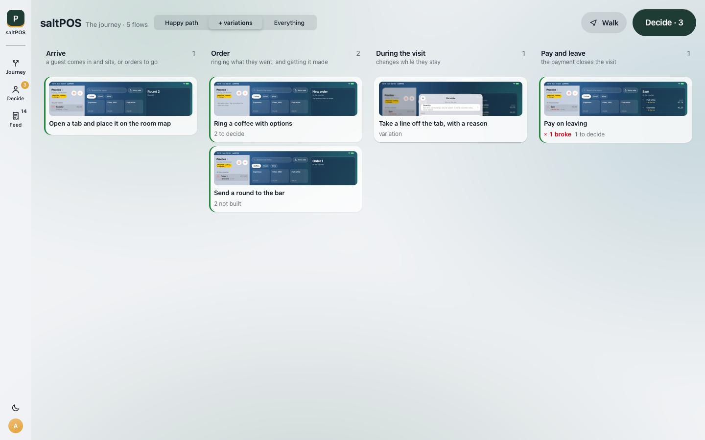
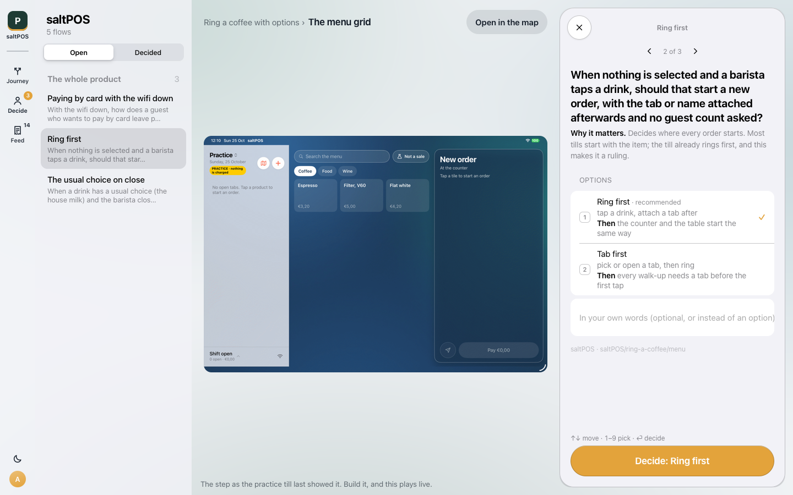

# saltFlow

saltFlow shows you a software product the way a person moves through it: every flow as a path, the real screen at
every step, and the reason behind every choice. It is a review tool for the founder or product manager, and the
product's own AI coding agent keeps it up to date.

saltFlow stores nothing of your product. It reads plain JSON files that live in your repo under `flows/`, checks
them, walks them, and serves a review page on your own machine. What it writes back is in `flows/`: notes, answers
to decisions, what the last walk reached, and screenshots. The one file outside your repo is the list of products
the page's switcher offers, `~/.saltflow/products.json`, with each product's name and path; `saltflow init
--no-register` skips it, and `SALTFLOW_HOME` moves it.

saltFlow is source-available, not open source: free for non-commercial use, commercial use by agreement. See
[Licence](#licence).

## Quickstart

You need Python 3.9 or newer. saltFlow uses only the standard library, so installing it pulls in nothing else.

Install it with one of these:

    uv tool install git+https://github.com/atrouwee/saltflow
    pipx install git+https://github.com/atrouwee/saltflow
    pip install git+https://github.com/atrouwee/saltflow

Then check your machine and open the example product:

    saltflow doctor      # what is installed, what is missing, and how to fix it
    saltflow demo        # opens the review page on a small bundled example

The page opens at http://127.0.0.1:5318/. Tap a tile to open a flow, tap a step to see its screen, and leave a note
on anything.

## Use it on your product

    cd your-repo
    saltflow init        # writes flows/saltflow.json, flows/README.md and a .gitignore line
    saltflow validate    # checks every flow file and says which field is wrong
    saltflow             # the review page, which follows the files as they change

`saltflow init` writes `flows/README.md`, the guide for whoever writes the flows. In practice that is your AI coding
agent (Claude Code, Codex, Cursor and the like): point it at `flows/README.md` and ask it to write a flow beside each
screen it builds. The guide tells it what to write, where, and the rules it must keep. You review on the page; it
reads your notes and decisions from `flows/notes.jsonl` before its next change.

### A first flow by hand

The smallest product that validates and walks is three files. Here the product is called `shop`, the name `init`
put in `flows/saltflow.json`; a ref reads `<product>:<source>#<id>`.

`flows/jobs.json`, the jobs people come to get done:

    {"schema": "saltflow/v1/jobs",
     "jobs": [{"id": "pay", "name": "Pay for what is in the basket"}]}

`flows/surfaces.json`, every surface once, its parts as boxes in percent of it (`init` writes it empty):

    {"schema": "saltflow/v1/surfaces",
     "surfaces": {
       "basket": {"name": "The basket", "place": "home", "client": "page",
                  "regions": [{"role": "list", "label": "The items", "x": 0, "y": 0, "w": 100, "h": 80},
                              {"role": "actions", "label": "Pay", "x": 0, "y": 80, "w": 100, "h": 20}]},
       "paid": {"name": "Paid", "place": "overlay", "client": "page",
                "regions": [{"role": "message", "label": "Thanks, paid", "x": 0, "y": 0, "w": 100, "h": 100}]}}}

`flows/checkout.json`, one flow: its steps, the moves between them, and the runs the walk must reach:

    {"schema": "saltflow/v1/flow", "id": "checkout", "name": "Pay for the basket", "product": "shop",
     "jobs": [{"ref": "shop:jobs#pay", "ends": ["paid"]}],
     "entry": "basket",
     "steps": {"basket": {"surface": "basket", "place": "home", "built": true},
               "paid": {"surface": "paid", "place": "overlay", "built": false, "end": "done"}},
     "moves": [{"id": "pay", "from": "basket", "to": "paid", "kind": "forward", "trigger": "Pay"}],
     "runs": [{"id": "happy", "job": "shop:jobs#pay", "world": {}, "expect": "done"}]}

`saltflow validate` then says `valid`, and `saltflow walk` says the run stops at `paid` because that step is not
built yet: work to do, not a break. Set `"built": true` once the screen exists. Conditions (online or not, card
accepted or declined) go in the flow's `world`, and a move that needs one says so in `needs`; `flows/README.md` and
[examples/saltpos](examples/saltpos) show the rest.

The full model, piece by piece, is in [docs/model.md](docs/model.md). What a well-covered product looks like is in
[docs/bar.md](docs/bar.md).

## The ideas, in plain words

- A **flow** is one job a person gets done, as a path: paying a bill, closing the day. Flows branch, loop, go back
  and fail, and saltFlow draws all of that.
- A **step** is one thing arriving on screen in a flow. Not the whole screen: the bill, not "the till with the bill
  open".
- A **surface** is that thing, described once and shared by every flow that uses it. It carries a simple drawing
  of its parts, so a flow reads before any screen is built.
- A **move** is a way from one step to the next: a tap, a key, or something that happens by itself (a card is
  declined, the wifi drops).
- A **walk** tries every flow under every combination of its conditions (online or not, card accepted or declined).
  Each try is a **run**. A run that does not reach what the design promises becomes a note.
- A **capture** is a real screenshot of a step, taken from your build so the page can show the real thing one tap
  away from the drawing.
- A **decision** is a question your agent puts to you, with options and one recommended. You answer on the page with
  a tap or in your own words, and the answer lands in the repo.
- A **note** is anything left on a step: a question, a change, a bug. Your agent takes it, makes the change, and
  closes it with the commit.

## Commands

| Command | What it does |
|---|---|
| `saltflow` | serve the review page for the product you are in |
| `saltflow doctor` | check Python, the flows, Node, Playwright and WebKit, with a fix for each miss |
| `saltflow demo` | open the page on the bundled example |
| `saltflow init` | set up `flows/` in your repo |
| `saltflow validate` | check every flow file against the model; changes nothing |
| `saltflow walk` | walk every flow through every combination of its conditions |
| `saltflow lint` | structural checks: no way back, unreachable steps, a button whose words differ from the flow |
| `saltflow coverage` | which of the product's jobs have a flow, and which do not yet |
| `saltflow bar` | the product's level against [the bar](docs/bar.md) |
| `saltflow needs` | what the page still needs from your agent: captures, sketches, follow-up lines |
| `saltflow capture` | build the product, play each flow in it and save a screenshot of every step |
| `saltflow notes` | list notes; take, close or reopen one |
| `saltflow ask` | put a decision to the reviewer, with options and one recommended |
| `saltflow hook` | install a git hook that walks, lints and captures after each commit |
| `saltflow publish` | write the page as one static HTML file, for someone without the repo |

Every command has `--help`. `walk`, `lint` and `coverage` report and never fail. `validate` exits 1 when a file is
wrong, so it can gate a commit or CI; it never changes a file.

## Screenshots of a web app

`saltflow capture` drives your web build in WebKit through Playwright. That part needs Node.js and is optional: the
rest of saltFlow runs on Python alone. To set it up in your repo:

    npm i -D playwright
    npx playwright install webkit

`saltflow doctor` tells you what is missing.

## Native apps

saltFlow never drives a native app itself. It reads the UI tests you already have. Give each screen element an
accessibility identifier `surface.<surface id>` and each control `move.<move id>`, and have your XCUITests attach a
screenshot and the view hierarchy at every step a flow names. Then:

    saltflow capture --xcresult path/to/Tests.xcresult

files the screenshots and checks the controls against the flows. This needs macOS and Xcode. The details are in
`flows/README.md`, under "A native app".

## On a phone or tablet

The page works at phone width. `saltflow --lan` also serves it on your local network so you can review on a phone or
tablet on the same wifi. The page has no login: anyone on that network can read it and leave notes. See
[SECURITY.md](SECURITY.md).

## Licence

saltFlow is licensed under the [PolyForm Noncommercial License 1.0.0](LICENSE).

- Free for any non-commercial use: personal projects, study, research, hobby work.
- Free for charities, schools, public research bodies and government institutions, whatever their funding.
- Commercial use (using it in or for a business) needs an agreement. See [COMMERCIAL.md](COMMERCIAL.md). Trying it
  out at work? Ask first.

## Contributing

Contributions are welcome. Read [CONTRIBUTING.md](CONTRIBUTING.md) first: every contribution comes in under a short
contributor licence agreement, [CLA.md](CLA.md). Please also read the [code of conduct](CODE_OF_CONDUCT.md).
